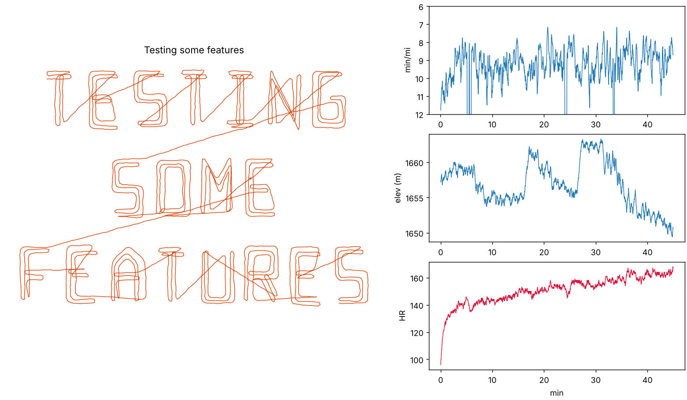

# strava-text-run

Turn text into a GPS-art running activity (GPX) that you can upload to Strava or any other app that reads GPX.



## Usage

```
pip install -r requirements.txt
python3 textrun.py "Testing some features" -o run.gpx --preview run.png --seed 7
```

Useful flags: `--miles`, `--pace 9:00`, `--lat/--lon`, `--start <ISO UTC>`, `--thickness N` (parallel passes per stroke, 1 = thin), `--max-chars` (wrap width, `|` forces a line break), `--stops`, `--hilliness`, `--full-cadence`. Run with `-h` for the full list.

## How it works

- **Text to route:** a blocky one-stroke font. Strokes are traced as parallel passes, going out along one edge and back along the other, so the letters look thick. Pen-up links between strokes are the diagonal connector lines.
- **Pace:** correlated variation on three timescales, soft-capped in log space, plus warm-up, fatigue, hill and corner slowdowns, acceleration limits and short stops.
- **Elevation:** a smooth function of position, so passing the same spot twice gives the same height. Grade is capped, with slow barometer-style noise.
- **GPS, HR, cadence, temperature:** correlated GPS jitter and rounded corners. Heart rate lags effort and drifts upward, and cadence follows speed.
- Distance and average pace are calibrated to the requested targets.

## Notes

- Cadence is written per-foot by default, which is how Strava reads GPX. Use `--full-cadence` if your app shows half the value.
- Meant for fun and private testing. Upload as **Only You**. Posting made-up activities as real ones, or to leaderboards and segments, goes against Strava's terms.
